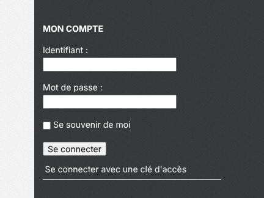
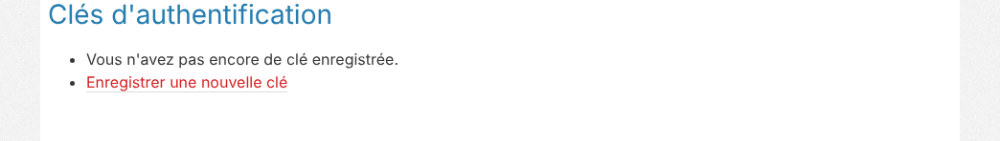
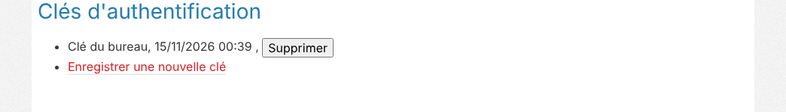

# FrontendWebauthn : guide d'utilisation

FrontendWebauthn permet à vos visiteurs de se connecter au blog avec une clé d'accès (passkey) : empreinte, reconnaissance du visage, code de l'appareil ou clé de sécurité USB, au lieu d'un mot de passe. Il complète le plugin FrontendSession, qui doit être installé et activé.

## Table des matières

1. [Prérequis](#prérequis)
2. [Afficher le lien de connexion](#afficher-le-lien-de-connexion)
3. [Enregistrer une clé](#enregistrer-une-clé)
4. [Se connecter avec une clé](#se-connecter-avec-une-clé)
5. [Supprimer une clé](#supprimer-une-clé)
6. [Bon à savoir](#bon-à-savoir)

## Prérequis

* Le plugin FrontendSession doit être activé dans les réglages du blog (voir son guide).
* Le blog doit être servi avec un nom de domaine (ou `localhost`) et, en production, en HTTPS. Les clés d'accès ne fonctionnent pas avec une adresse IP.
* Le navigateur du visiteur doit gérer les clés d'accès. Sinon, les liens du plugin restent cachés.

Le plugin n'a aucun réglage et pas de page d'administration.

## Afficher le lien de connexion

Dans **Gadgets**, ajoutez le gadget « Session publique » de FrontendSession. Quand un visiteur n'est pas connecté, le gadget affiche, sous le formulaire, le lien **Se connecter avec une clé d'accès**.

Le lien n'apparaît que dans ce gadget : la page « Mon compte » ne le propose pas.

## Enregistrer une clé

Le visiteur se connecte d'abord avec son identifiant et son mot de passe. Sur la page « Mon compte », la rubrique **Clés d'authentification** indique qu'il n'a pas encore de clé.

Il clique sur **Enregistrer une nouvelle clé**, saisit un nom pour la clé dans la fenêtre qui s'ouvre, puis valide avec son appareil. La clé apparaît dans la liste avec sa date d'enregistrement.

## Se connecter avec une clé

Un visiteur déconnecté clique sur **Se connecter avec une clé d'accès** dans le gadget, puis valide avec son appareil. Il n'a pas à saisir d'identifiant : la clé suffit. La page se recharge et il est connecté.

Si l'appareil ne possède aucune clé enregistrée pour ce blog, un message « Impossible de s'authentifier avec une clé » s'affiche.

## Supprimer une clé

Dans la rubrique « Clés d'authentification », cliquez sur **Supprimer** en face de la clé. La clé est retirée du blog ; pensez aussi à la supprimer de votre appareil si vous ne l'utilisez plus.

## Bon à savoir

* Après un clic sur « Supprimer », la page affiche une erreur « 571 : Something went wrong while loading template file for your blog. WebAuthn can not be started twice. » alors que la clé est bien supprimée. Rechargez la page « Mon compte » pour retrouver la liste à jour.
* Un même appareil ne peut généralement pas enregistrer deux clés pour le même compte : l'enregistrement échoue avec un message d'erreur.
* Certains textes restent en anglais : la fenêtre « Enter key name: » et l'infobulle « Unknown passkey. » au survol du nom d'une clé.
